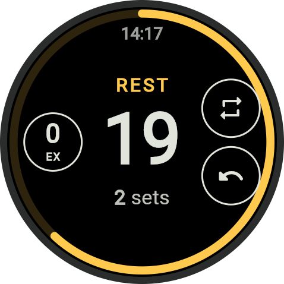
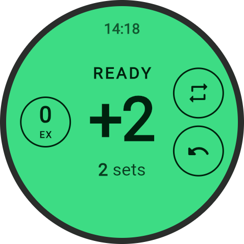
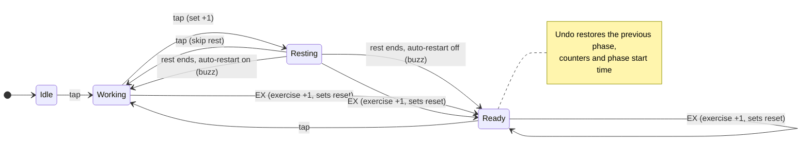
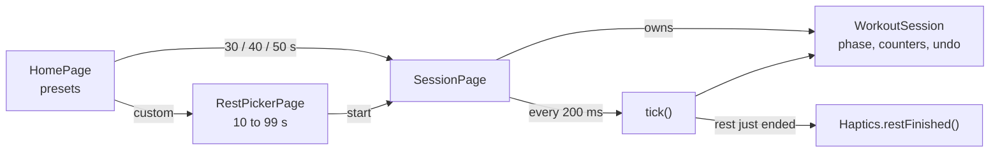

<div align="center">

# Gym Helper

**A rest timer and set counter for Wear OS that you drive with one tap per set, without looking at your wrist.**

[](https://github.com/LeonardoSola/gym-helper/actions/workflows/ci.yml)
[](https://flutter.dev)
[](https://dart.dev)
[](https://wearos.google.com)
[](LICENSE)

<br>

<table>
  <tr>
    <td align="center" width="20%">
      <br>
      <sub><b>Pick a rest</b><br>30, 40, 50 s or custom</sub>
    </td>
    <td align="center" width="20%">
      <br>
      <sub><b>GO</b><br>set timer counts up</sub>
    </td>
    <td align="center" width="20%">
      <br>
      <sub><b>REST</b><br>countdown and edge ring</sub>
    </td>
    <td align="center" width="20%">
      <br>
      <sub><b>READY</b><br>full green screen</sub>
    </td>
    <td align="center" width="20%">
      <br>
      <sub><b>Custom rest</b><br>10 to 99 s</sub>
    </td>
  </tr>
</table>

</div>

## Contents

- [Features](#features)
- [How a session works](#how-a-session-works)
- [Design decisions](#design-decisions)
- [Getting started](#getting-started)
- [Architecture](#architecture)
- [Testing](#testing)
- [Continuous integration](#continuous-integration)
- [Known limitations](#known-limitations)
- [Roadmap](#roadmap)
- [Privacy](#privacy)
- [License](#license)

## Features

- **One-tap flow.** The whole screen is the button: tap when you finish a set to start resting, and tap again to start the next one.
- **Rest presets.** 30, 40 and 50 seconds on the home screen, or any value from 10 to 99 seconds on two scroll wheels (tens and units).
- **Readable mid-set.** Large timer digits with tabular figures so they do not jitter, a distinct colour per phase and a countdown ring that follows the edge of a round watch face.
- **Haptic cues.** A double buzz (400 ms, pause, 400 ms) when rest is over and a light tick on every tap.
- **Set and exercise counters.** Sets are counted when you finish one. Finishing an exercise adds to the exercise count and resets the sets.
- **Auto-restart.** Optionally start the next set the moment rest ends, which suits circuits.
- **Undo.** Reverts the last tap completely, including the phase and the original timer, with up to 100 steps of history.
- **Screen stays on** for the whole session, and goes back to normal when you leave it.
- **Watch clock** in `HH:mm` at the top of every screen.
- **Accessible.** Every control has a semantic label for TalkBack, and the auto-restart button is announced as toggled when it is on.
- **Private.** Works fully offline, with no accounts, ads, analytics or network access.

## How a session works

Pick a rest time on the home screen and the session screen opens in an idle state that shows the chosen rest and a play icon. From then on, the centre of the screen is one big button whose meaning depends on the phase.

| Phase | Colours | Timer shows | Tap the screen to |
| --- | --- | --- | --- |
| **Idle** | Black, green accent | `REST 40s` and a play icon | Start the first set |
| **GO** | Black, green accent | Time spent on the current set, counting up | Finish the set (counts it) and start resting |
| **REST** | Black, amber accent and ring | Seconds left, rounded up so it never shows `0` early | Skip the rest and start the next set (no extra set counted) |
| **READY** | Full green screen, dark text | `+12`: time since the rest ended | Start the next set |

Times under a minute show as plain seconds (`42`); from one minute on they show as `1:05`.

The side controls appear once the first set starts. Until then they are hidden and ignore taps, but keep their space so the layout does not jump.

| Control | Position | Action |
| --- | --- | --- |
| **EX** | Left | Finish the current exercise: exercise count +1, sets reset to 0, phase goes to READY |
| **Repeat** | Top right | Toggle auto-restart (filled when on) |
| **Undo** | Bottom right | Revert the last tap or exercise completion (dimmed when there is nothing to undo) |



A few details that matter in practice:

- **Undo is exact.** Each tap saves a snapshot of the phase, both counters and the moment the phase started. Undoing an accidental "finish set" tap puts you back in GO with the set timer still counting from when the set really began.
- **The rest end is precise.** When rest runs out, the next phase is timestamped at the exact moment rest ended, not at whichever refresh noticed it. With auto-restart on, the new set timer starts from the real end of the rest.
- **The buzz fires once.** The rest-finished alert is triggered exactly once per rest period.
- **Auto-restart is a setting, not a step.** Toggling it is not recorded in the undo history.

## Design decisions

- **Watch first.** Layouts are sized from the shortest side of the screen, and the home grid sits inside the square inscribed in a round display. Widget tests run on a 227 x 227 dp screen, the size of a large round watch, so small-display layout problems show up in tests.
- **True black for OLED.** Backgrounds are pure `#000000`. On OLED screens black pixels are off, which saves battery and blends the UI into the bezel. The only full-colour screen is READY, on purpose: it is the one moment you need to notice at a glance.
- **Phase by colour, not just text.** Green (`#3DDC84`) means work, amber (`#FFC94D`) means rest. You can tell the phase from the corner of your eye without reading a label.
- **48 dp minimum targets.** Every control is at least 48 x 48 dp, the Material minimum, and side controls scale up to 64 dp on larger watches. The main action is the entire screen, because hands are sweaty and attention is elsewhere.
- **Haptics instead of looking.** A tick confirms each tap and a distinct double buzz ends the rest, so the app can be used with the wrist down. Vibration failures are ignored, since haptics are a nice-to-have and are not available everywhere (tests, browsers).
- **Dark only.** Wear OS system UI is dark and most watches are OLED, so there is a single Material 3 dark theme seeded from green. A light theme would never be seen and would cost battery.
- **Timestamps, not tick counting.** Elapsed time is computed from the clock, never by counting timer callbacks, so the display cannot drift even if a refresh is late.

## Getting started

### Prerequisites

- [Flutter](https://docs.flutter.dev/get-started/install) 3.35 or newer (the lockfile requires Dart 3.9+)
- Android SDK with the platform tools (`adb`) and JDK 17
- A Wear OS emulator (create one in Android Studio's Device Manager with a Wear OS system image) or a Wear OS watch

```bash
git clone https://github.com/LeonardoSola/gym-helper.git
cd gym-helper
flutter pub get
```

### Run on a Wear OS emulator

Start the emulator, then:

```bash
flutter devices        # the emulator should be listed
flutter run            # or: flutter run -d <device-id>
```

### Run on a watch (adb over Wi-Fi)

1. On the watch, open **Settings > System > About** and tap **Build number** seven times to enable developer options.
2. In **Developer options**, turn on **ADB debugging** and **Debug over Wi-Fi** (called **Wireless debugging** on newer Wear OS versions). Keep the watch and the computer on the same network.
3. Connect from the computer, using the IP address and port shown on the watch:

   ```bash
   # Newer Wear OS: pair first with the code shown under "Pair new device"
   adb pair <watch-ip>:<pairing-port>

   adb connect <watch-ip>:<port>
   adb devices            # the watch should be listed
   flutter run -d <watch-ip>:<port>
   ```

### Build an APK

```bash
flutter build apk --debug      # build/app/outputs/flutter-apk/app-debug.apk
flutter build apk --release    # build/app/outputs/flutter-apk/app-release.apk
adb install build/app/outputs/flutter-apk/app-release.apk
```

For the Play Store, build an app bundle instead with `flutter build appbundle --release`. Release builds have code and resource shrinking enabled.

### Release signing

`android/app/build.gradle` looks for `android/key.properties`. When the file exists, release builds are signed with that key. When it does not, they fall back to the debug key, so a fresh clone always builds. Create the file like this:

```properties
storePassword=<keystore password>
keyPassword=<key password>
keyAlias=upload
storeFile=/absolute/path/to/upload-keystore.jks
```

A relative `storeFile` is resolved from `android/app/`. `key.properties`, `*.jks` and `*.keystore` are git-ignored, so keys never end up in the repository. See the [Flutter signing guide](https://docs.flutter.dev/deployment/android#sign-the-app) for creating a keystore.

## Architecture

The app has three screens and one piece of logic. All timing and counting lives in `WorkoutSession`, a plain `ChangeNotifier` with no widgets in it. The UI only renders its state and forwards taps.



- **Injectable clock.** `WorkoutSession` reads time from a `DateTime Function()` passed to its constructor, so tests control time directly instead of waiting on real timers.
- **Refresh loop.** `SessionPage` calls `tick()` every 200 ms, shorter than a second so the countdown never visibly lags. `tick()` returns `true` exactly once when a rest finishes, and the page uses that to buzz.
- **Bounded history.** Undo snapshots are capped at 100 entries.
- **Lifecycle.** The session page enables the wakelock and starts the refresh timer when it opens, and releases both when it closes.

### Project structure

```
lib/
├── main.dart                   # MaterialApp with the dark theme, opens HomePage
├── models/
│   └── workout_session.dart    # Phases, timers, counters, undo, formatting helpers
├── pages/
│   ├── home_page.dart          # 2 x 2 grid: three presets and a custom button
│   ├── rest_picker_page.dart   # Two looping wheels (tens, units), 10 to 99 s
│   └── session_page.dart       # Training screen, refresh loop, wakelock
├── theme/
│   └── app_theme.dart          # True-black Material 3 theme, phase colours, timer text style
├── utils/
│   └── haptics.dart            # Tap tick and rest-finished double buzz
└── widgets/
    ├── circle_button.dart      # Large round preset button
    ├── rest_ring.dart          # Countdown ring painted along the watch edge
    ├── round_icon_button.dart  # 48 dp+ side control with toggle state
    ├── top_clock.dart          # HH:mm clock
    └── watch_scaffold.dart     # Black background, safe area and clock
test/
├── workout_session_test.dart   # Unit tests for the session logic (fake clock)
├── session_page_test.dart      # Widget tests for the training screen
├── app_test.dart               # Navigation from the home screen
└── test_utils.dart             # 227 x 227 dp watch-sized test screen
```

### Dependencies

| Package | Used for |
| --- | --- |
| [`vibration`](https://pub.dev/packages/vibration) | The rest-finished vibration pattern |
| [`wakelock_plus`](https://pub.dev/packages/wakelock_plus) | Keeping the screen on during a session |
| [`intl`](https://pub.dev/packages/intl) | Formatting the `HH:mm` clock |
| [`flutter_lints`](https://pub.dev/packages/flutter_lints) | Static analysis rules (dev) |
| [`flutter_launcher_icons`](https://pub.dev/packages/flutter_launcher_icons) | Generating the launcher icon (dev) |

The Android manifest declares a standalone Wear OS app (`android.hardware.type.watch` required) and asks only for `WAKE_LOCK` and `VIBRATE`.

## Testing

```bash
flutter analyze
flutter test
```

| Suite | What it covers |
| --- | --- |
| `workout_session_test.dart` | Starting idle; set timer counting up; finishing a set counts it and starts rest; rest ending exactly once into READY; auto-restart going straight to the next set; skipping rest without counting a set; completing an exercise (and ignoring it before the start); undo keeping the original set timer, restoring a completed exercise, stepping back to the start and staying bounded; listener notifications; `formatTimer` and `ceilToSecond` |
| `session_page_test.dart` | A full set, rest and READY cycle on screen; undo after an accidental tap; auto-restart skipping READY; finishing an exercise resetting the sets; side controls hidden and inert before the start |
| `app_test.dart` | Home shows the presets and custom option; a preset opens a session with that rest; the picker starts a session with the chosen time |

Unit tests drive a fake clock. Widget tests inject a clock into `SessionPage` and render on a watch-sized 227 x 227 dp screen.

## Continuous integration

[`.github/workflows/ci.yml`](.github/workflows/ci.yml) runs on every push to `main` and on every pull request. It sets up Flutter stable (with caching) on Ubuntu, then runs `flutter pub get`, `flutter analyze` and `flutter test`.

## Known limitations

- **No alert in the background.** The rest countdown and its buzz come from a timer inside the session screen. There is no foreground service, alarm or notification, so if the app leaves the screen or the system stops it, the rest-finished buzz may not fire.
- **Nothing is persisted.** Auto-restart, the chosen rest time and the counters live in memory only. Leaving the session screen or closing the app resets them, and the picker always opens at 60 s.
- **No ambient mode.** The app keeps the screen fully on during a session instead of switching to a low-power ambient display.
- **Touch only.** The rest picker does not respond to the rotating crown or bezel.
- **Undo does not cover auto-restart.** Toggling it is not part of the undo history.
- **Rest range.** Custom rest times go from 10 to 99 seconds. Longer rests are not supported.

## Roadmap

Ideas under consideration, not commitments:

- Reliable background alerts with a foreground service or exact alarm
- Remember the last rest time and the auto-restart setting
- Ambient mode support
- Rotary input for the rest picker
- Rest times longer than 99 seconds
- An optional session summary (sets, exercises, total time)

## Privacy

Gym Helper collects no data. It has no accounts, no analytics, no ads and no network access. Timers and counters exist only in memory while the app is running. The only permissions are `WAKE_LOCK` (keep the screen on) and `VIBRATE` (haptic alerts). See the full [privacy policy](PRIVACY_POLICY.md) (in Portuguese).

## License

[MIT](LICENSE) © 2026 Leonardo Sola

<br>

<div align="center">

Built by **Leonardo Sola** · Portfolio: [sola.dev.br](https://sola.dev.br) · LinkedIn: [leonardo-sola](https://www.linkedin.com/in/leonardo-sola/)

[](https://sola.dev.br)
[](https://www.linkedin.com/in/leonardo-sola/)

</div>
