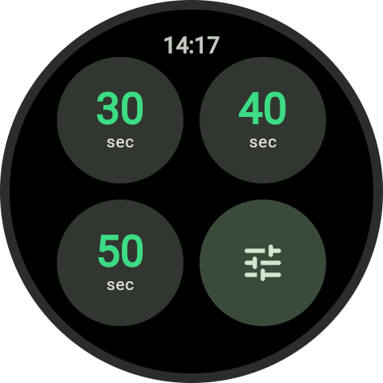
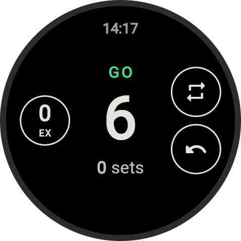
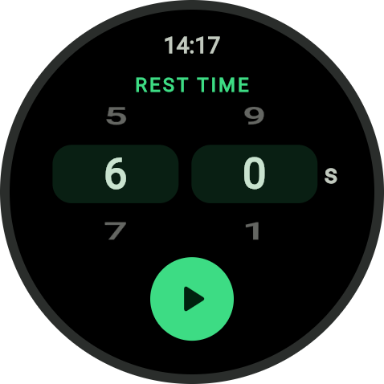

# Gym Helper

[](https://github.com/LeonardoSola/gym-helper/actions/workflows/ci.yml)
[](LICENSE)

A rest timer and set counter for Wear OS that you drive with one tap per set, without looking at your wrist.

<p align="center">
  
  
  
  
</p>

## Features

- **One-tap flow.** The whole screen is the button: tap when you finish a set to start resting, and tap again to start the next one.
- **Rest presets.** 30, 40 and 50 seconds, or any custom value from 10 to 99 seconds.
- **Easy to read mid-set.** Big tabular digits, a different colour for each phase and a countdown ring around the edge of the watch face.
- **Haptic alerts.** A double buzz when rest is over and a light tick on every tap.
- **Set and exercise counters.** Sets are counted automatically. Finishing an exercise resets the set count.
- **Auto-restart.** Optionally start the next set the moment rest ends, which is handy for circuits.
- **Undo.** Reverts the last tap completely, including the phase and its timer, so an accidental tap costs nothing.
- **Screen stays on** for the whole session.
- **Private.** Works fully offline, with no accounts, ads or analytics. See the [privacy policy](PRIVACY_POLICY.md).

## How it works

| Phase | What you see | Tap the screen to |
| --- | --- | --- |
| **GO** | Time spent on the current set | Finish the set and start resting |
| **REST** | Seconds left, with the ring emptying | Skip the rest and start the next set |
| **READY** | Green screen and time since the rest ended | Start the next set |

The side controls are:

- **EX (left):** finish the current exercise. Adds one to the exercise count and resets the sets.
- **Repeat (top right):** turn auto-restart on or off.
- **Undo (bottom right):** revert the last tap.

<p align="center">
  
</p>

## Getting started

Requirements: [Flutter](https://docs.flutter.dev/get-started/install) 3.35 or newer (Dart 3.8+), plus the Android SDK and either a Wear OS emulator or a Wear OS watch.

```bash
git clone https://github.com/LeonardoSola/gym-helper.git
cd gym-helper
flutter pub get

# Start a Wear OS emulator (create one in Android Studio's Device Manager), then:
flutter run
```

Run the checks:

```bash
flutter analyze
flutter test
```

Build a release:

```bash
flutter build appbundle --release
```

Release builds are signed with the key in `android/key.properties` when that file exists ([format](https://docs.flutter.dev/deployment/android#reference-the-keystore-from-the-app)). Without it they fall back to the debug key, so a fresh clone always builds.

## Tech stack

- [Flutter](https://flutter.dev) and Dart, with Material 3
- [`vibration`](https://pub.dev/packages/vibration) for haptic alerts
- [`wakelock_plus`](https://pub.dev/packages/wakelock_plus) to keep the screen on during a session
- [`intl`](https://pub.dev/packages/intl) for the clock
- GitHub Actions running `flutter analyze` and `flutter test`

## Project structure

```
lib/
├── main.dart                   # App entry point
├── models/
│   └── workout_session.dart    # Timer, set and exercise logic (no UI)
├── pages/
│   ├── home_page.dart          # Rest time presets
│   ├── rest_picker_page.dart   # Custom rest time (10 to 99 s)
│   └── session_page.dart       # Training screen
├── theme/
│   └── app_theme.dart          # Material 3 dark theme and phase colours
├── utils/
│   └── haptics.dart            # Tap and rest-finished vibrations
└── widgets/                    # Buttons, rest ring, clock, shared scaffold
test/
├── workout_session_test.dart   # Unit tests for the session logic (fake clock)
├── session_page_test.dart      # Widget tests for the training screen
└── app_test.dart               # Navigation from the home screen
```

The session logic lives in `WorkoutSession`, a plain `ChangeNotifier` that reads time from an injectable clock. Elapsed time comes from timestamps rather than from counting timer ticks, so the countdown never drifts and the logic can be unit tested without real timers.

## Design notes

- **Dark only, on purpose.** Wear OS is a dark platform and most watches have OLED screens, so the app uses a true-black theme. A light mode would never be seen.
- **Built for sweaty hands.** Every control is at least 48 dp, and the main action is the entire screen.
- **Readable at a glance.** Phases differ in colour as well as text: green for working, amber for resting and a full green screen when it is time to go.

The screenshots come from a Flutter web build rendered at 227 x 227 dp, the size of a large round watch.

## License

[MIT](LICENSE) © Leonardo Sola
